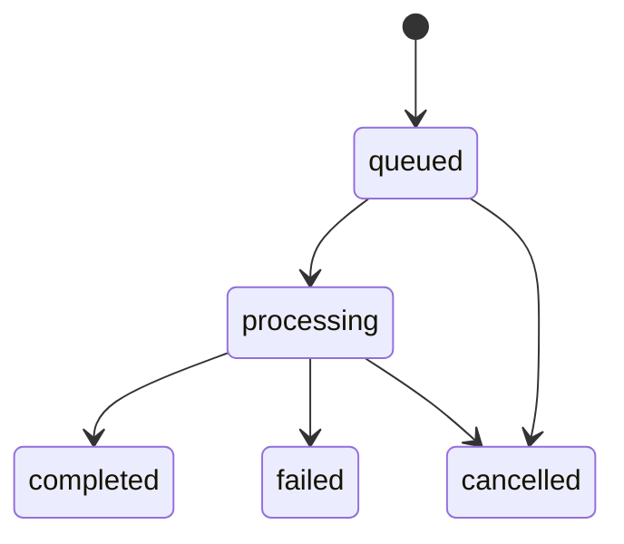

# Mark2Audio — Architecture

Backend as built, then the mandatory technical rules. Related docs, each fact lives in one place:
[ROADMAP.md](ROADMAP.md) (goals, sprints) · [DESIGN.md](DESIGN.md) (UI) ·
[DECISION.md](DECISION.md) (decisions, deviations) ·
[CLAUDE.md](../CLAUDE.md#21-project-mark2audio) (workflow, git, skills).

## Overview

Modular monolith, two processes from one image, no broker:

- **api**: FastAPI (`app.main:create`), REST under `/api/v1`, also serves the web UI.
- **worker**: `python -m app.worker`, polls SQLite, runs one conversion at a time.

SQLite (`data/mark2audio.db`) holds books and jobs. Files live under `data/`. TTS and FFmpeg run
locally; no network at conversion time.

## Modules

All under `backend/app/`.

| File                | Role                                                                   |
| ------------------- | ---------------------------------------------------------------------- |
| `main.py`           | `create()` app factory                                                 |
| `api.py`            | `create_app(settings, engine)`: router, error handlers, static UI      |
| `config.py`         | `Settings` frozen dataclass, `Settings.from_env()`                     |
| `errors.py`         | `AppError(code, message, status)`                                      |
| `migrate.py`        | `migrate(db_path, folder)`: versioned SQL migrations (D-023, D-028)    |
| `migrations/`       | `NNN_name.sql`, applied in order: `001_baseline`, `002_chapters`       |
| `parser.py`         | `parse_markdown(text, include_code)` → `Chapter` list (markdown-it-py) |
| `chunker.py`        | `chunk_chapters(chapters, max_chars)` → `Chunk` list                   |
| `schemas.py`        | Pydantic response models, the public API contract (D-024)              |
| `tts.py`            | `TtsEngine` protocol, `FakeTts`, `load_engine`, `SPEED_RANGE`          |
| `tts_kokoro.py`     | `KokoroTts` adapter, verified with the real model (D-017)              |
| `encoder.py`        | `WavSink`, `ffmpeg_args`, `encode_mp3`, `probe_mp3`                    |
| `storage.py`        | `book_dir`, `remove_tree`: UUID-only, containment-checked paths        |
| `store.py`          | `Store`: SQLite access, state machine, atomic claim                    |
| `worker.py`         | `run_pending`, `main` loop                                             |
| `static/index.html` | UI, see [DESIGN.md](DESIGN.md)                                         |

## Configuration

| Env var                | Default         | Field                                             |
| ---------------------- | --------------- | ------------------------------------------------- |
| `M2A_DATA_DIR`         | `data`          | `data_dir`                                        |
| `M2A_MODEL_DIR`        | `models/kokoro` | `model_dir`                                       |
| `M2A_MAX_UPLOAD_BYTES` | `10485760`      | `max_upload_bytes`                                |
| `M2A_CHUNK_MAX_CHARS`  | `400`           | `chunk_max_chars`                                 |
| `M2A_SILENCE_MS`       | `350`           | `silence_ms`                                      |
| `M2A_POLL_SECONDS`     | `1.0`           | `poll_seconds`                                    |
| `M2A_FAKE_TTS`         | unset           | read in `tts.load_engine`; `1` = sine-tone engine |

Fixed, not env-driven: FFmpeg timeout 1800 s (`ffmpeg_timeout_s`), probe timeout 60 s,
speed range 0.8–1.2, heartbeat file `data/worker.heartbeat` ([D-020](DECISION.md#d-020--worker-health-check-by-heartbeat-file)).
Template: `.env.example`.

## Data model

`Store` runs the migrations on start (see [Migrations](#migrations)). Foreign keys ON.

- `books`: `id`, `title`, `original_filename`, `chapter_count`, `created_at`, `duration_seconds`
  (NULL until a conversion completes).
- `jobs`: `id`, `book_id` (cascade delete), `status`, `voice_id`, `language`, `speed`,
  `bitrate_kbps`, `include_code_blocks`, `total_chunks`, `completed_chunks`, `progress_percent`,
  `current_chapter`, `error_code`, `error_message`, `created_at`, `started_at`, `completed_at`.
- `chapters`: `book_id` (cascade delete), `number`, `title`, `start_seconds`, `duration_seconds`;
  primary key `book_id, number`. Rows are written with the book at upload
  (`include_code=False`); books uploaded before v0.3.0 are backfilled on the first
  `GET /books/{id}`. Timing stays NULL until a conversion completes.
- Book status is derived from the latest job (`queued`, `processing`, `completed`, `failed`),
  else `uploaded`.
- Every operation opens a fresh connection with a short `BEGIN IMMEDIATE` transaction (api and worker
  are separate processes). No transaction is held during TTS.

### Migrations

- Ordered files in `backend/app/migrations/`, version in `PRAGMA user_version`.
- All pending files run in one `BEGIN IMMEDIATE` transaction, statement by statement; the version
  is re-read under the lock, so api and worker can start together. Any failure rolls back all.
- Before migrating a database that has tables, it is copied to `mark2audio.db.pre-v<N>` (`N` =
  target version).
- A database newer than the highest file raises `DB_TOO_NEW` (500) and the process does not start.

## Job lifecycle



- Transitions validated in `Store.transition`; anything else → `INVALID_TRANSITION` (409).
- Claim: single `UPDATE … WHERE status='queued' … RETURNING` on the oldest queued job.
- Create or delete while a job is queued/processing for the book → `JOB_ACTIVE` (409).
  Create for a deleted book → `BOOK_NOT_FOUND` (404), checked in the same transaction.
  Retry = new job.
- Progress: `completed*100//total`, capped at 99 until the `completed` transition sets 100;
  never decreases; only written while `processing`.
- Worker start: `fail_stale()` marks `processing` jobs `failed` / `WORKER_RESTARTED`.
- Failure: `AppError` → `failed` with its code and message; out of disk space (`ENOSPC`) →
  `DISK_FULL`; any other exception → `INTERNAL`, generic message, stack trace in server log only.
- Cancel: status set to `cancelled` via API; worker checks before each chunk and before publish.
- `finally` always removes `data/temp/{job_id}` and `audiobook.mp3.part`.

## Conversion pipeline

`worker._convert`:

1. Read `uploads/{book_id}/source.md`; `parse_markdown(include_code=job.include_code_blocks)`.
2. No chapters → `NO_TEXT`.
3. `chunk_chapters(chapters, chunk_max_chars)`.
4. Per chunk, in order: cancel check → `engine.synthesize(text, voice, speed, language)` →
   `WavSink.write` → `WavSink.silence(silence_ms)` → `set_progress` → `beat`.
5. `beat`, then `encode_mp3` (FFmpeg, argument list, timeout) to `audiobook.mp3.part`; `probe_mp3` validates.
6. Cancel check; `os.replace` to `audiobook.mp3` (atomic); `Store.complete_job` sets
   `completed`, replaces the book's chapter rows with start and duration, and sets
   `chapter_count` and `duration_seconds`, in one transaction. A cancelled job writes nothing.

Chapter timing comes from samples per chunk; silence after a chunk belongs to the chapter before
it. Book duration comes from `probe_mp3`, so the chapter sum can differ slightly (MP3 padding).

The model is loaded once per worker process (`load_engine` in `main`).

## Measured performance

CPU only, 16 threads, 14 GiB RAM, Kokoro v1.0 through `kokoro-onnx` 0.6.1, run in a plain
Python process (not Docker), 2026-11-21:

- Speed: real-time factor about 0.2 (wall time is about 0.2 × audio length) for chunks of 400
  characters or more; a 100-character chunk measured 0.36 including first-call warmup. A
  one-hour book takes about 12 minutes.
- Memory: peak RSS about 1.3 GB in the process that holds the model. Only the worker loads it.
- In Docker (same machine): real-time factor about 0.24 (a 3.6-minute book in 52 s); worker
  peak about 0.95 GB, sampled once per second with `docker stats`.
- Chunk size: chunks up to 1600 characters synthesize without truncation, because `kokoro-onnx`
  splits long text itself (510 phonemes). `M2A_CHUNK_MAX_CHARS` therefore only bounds memory and
  progress granularity.

## API

Router prefix `/api/v1`. Every endpoint declares a `response_model` from `schemas.py`; books
carry `duration_seconds`, book detail adds `chapters` (`number`, `title`, `start_seconds`,
`duration_seconds`) and `latest_job`. Errors: `{"error": {"code", "message"}}`, documented in
OpenAPI as `ErrorResponse` (422 included), via handlers for `AppError` and
request-validation errors, and a catch-all that returns `INTERNAL` (500) with the trace in the
server log only. `DISK_FULL` is 507, `SOURCE_MISSING` (book file gone) is 500. A failed upload
removes its folder. Book and job ids are UUIDs.

| Method   | Path                       | Success   |
| -------- | -------------------------- | --------- |
| `GET`    | `/health`                  | 200       |
| `POST`   | `/books/upload`            | 201       |
| `GET`    | `/books`                   | 200       |
| `GET`    | `/books/{book_id}`         | 200       |
| `DELETE` | `/books/{book_id}`         | 204       |
| `GET`    | `/voices`                  | 200       |
| `POST`   | `/books/{book_id}/convert` | 202       |
| `GET`    | `/jobs/{job_id}`           | 200       |
| `POST`   | `/jobs/{job_id}/cancel`    | 200       |
| `GET`    | `/books/{book_id}/audio`   | 200 (MP3) |

## Storage

```text
data/uploads/{book_id}/source.md
data/audio/{book_id}/audiobook.mp3        (+ audiobook.mp3.part while publishing)
data/temp/{job_id}/book.wav               (removed after each job)
data/mark2audio.db
data/mark2audio.db.pre-v<N>                (copy taken before a migration)
models/kokoro/{kokoro-v1.0.onnx, voices-v1.0.bin}   (mounted, outside the image)
```

`storage.book_dir` accepts only UUIDs, resolves the path, and requires it to be a direct child of
the root (blocks traversal and symlink escape).

## Runtime

- `backend/Dockerfile`: `python:3.12.7-slim-bookworm`, FFmpeg, user uid 1000, dependencies from
  `uv.lock` via pinned `uv` 0.13.6 ([D-018](DECISION.md)).
- `docker-compose.yml`: services `api` (port `127.0.0.1:8000`, health check on `/api/v1/health`)
  and `worker` (waits for api healthy, health check from the heartbeat file). Volumes `./data:/data`,
  `./models/kokoro:/models:ro`; optional `.env`; `environment` pins `M2A_DATA_DIR=/data` and `M2A_MODEL_DIR=/models`
  (wins over `.env`); `restart: unless-stopped`.
- Native: `make api`, `make worker`, see `Makefile`.
- Worker health check ([D-020](DECISION.md#d-020--worker-health-check-by-heartbeat-file)): the worker touches `data/worker.heartbeat` after the
  model loads, on every idle poll, after every chunk and before encoding. Compose marks it
  healthy while the file is younger than 300 s (`start_period` 120 s). Verified 2026-11-22:
  `healthy` idle and while converting; `unhealthy` with the process stopped and the file aged;
  `healthy` again after resume, no restart. One FFmpeg encode over 300 s can show `unhealthy`;
  compose does not restart on it.
- Image built and run with Compose on 2026-11-21: a real-model conversion completes and the
  container writes `data/` through the bind mount (host and container uid are both 1000).
- Upgrade from v0.2.0 verified 2026-11-28 with Compose on a real `data/` (copy kept outside the
  repository; 7 books, 8 completed and 1 cancelled job, `user_version` 0): migrations `001` and
  `002` applied, `mark2audio.db.pre-v2` written, old books kept status and audio, chapter rows
  backfilled on first detail read with null timing, a new upload converted with book and
  chapter durations shown in the UI.
- Offline proof: `docker-compose.offline.yml` gives the worker `network_mode: none`. Run
  `docker compose -f docker-compose.yml -f docker-compose.offline.yml up -d --force-recreate worker`.
  On 2026-11-21 a worker with only a loopback interface, failing outbound connects and failing DNS
  converted a book with the real model. Restore with
  `docker compose up -d --force-recreate worker`.

## Tests

`backend/tests/`: `test_api`, `test_audio`, `test_chunker`, `test_migrate`, `test_openapi`,
`test_parser`, `test_store`, `test_worker`, `test_main`, `test_tts`, `test_kokoro_adapter`
(stub model), `test_smoke_kokoro` (real model and
FFmpeg, runs only when both exist; `make smoke`). `conftest.py` fixtures:
`settings` (tmp dirs, `chunk_max_chars=40`, `silence_ms=50`), `store`, `engine` (`FakeTts`).
Coverage gate 80% (`pyproject.toml`), `tts_kokoro.py` omitted.

Gates: `make lint typecheck test`. `make lint` runs every pre-commit hook except mypy
(`.pre-commit-config.yaml`: hygiene, gitleaks, codespell, pyproject-fmt, ruff, uv-lock,
prettier; ruff `S` rules replace bandit, [D-014](DECISION.md)) and **fixes files**; CI fails if it changed any.
Git hooks: checks on commit, commit-message format, pytest on push; `main` and `develop`
are blocked. CI (`.github/workflows/ci.yml`) calls the same make targets; run it locally with
`make ci` (`act`). The real-model smoke test is skipped in CI. Dependencies are locked in
`backend/uv.lock`, dev tools sit in the `dev` dependency group, Python 3.12
(`backend/.python-version`). Decisions: [D-012](DECISION.md), [D-019](DECISION.md) (Actions pinned by SHA).

## Optional tooling (off by default)

No hook, no CI job. Config in gitignored `.env.tools` (template `.env.tools.example`).
Decision: [D-013](DECISION.md).

- `make trivy`: builds `mark2audio:local`, scans it with the sibling `trivy-docker-scanner`
  repo (`TRIVY_DIR`). Reports land in that repo.
- `make sonar`: tests with a coverage XML, then SonarScanner (docker) against a local
  SonarQube (`SONAR_HOST_URL`, `SONAR_TOKEN`). Settings: `backend/sonar-project.properties`.
- `make ci`: the CI workflow locally via `act`.

## Technical rules

These rules are mandatory for implementation and code review unless a decision record in
[DECISION.md](DECISION.md) explicitly changes them. Git workflow and sprint flow:
[CLAUDE.md](../CLAUDE.md#21-project-mark2audio). UI rules: [DESIGN.md](DESIGN.md#rules).

### Architecture and scope

1. Build a modular monolith; do not split the MVP into microservices.
2. Runtime services are limited to frontend, API, and worker.
3. Use SQLite for metadata and job state.
4. Do not add Redis, RabbitMQ, PostgreSQL, MinIO, or cloud APIs to the MVP.
5. All TTS inference and audio processing must run locally.
6. Runtime conversion must not require outbound network access.
7. Keep model files and user data outside immutable container images.

### Python and dependency management

1. Use Python 3.12 or newer, pinned to a tested version in CI and Docker.
2. Use `uv` for dependency and environment management.
3. Declare runtime and development dependencies explicitly in `pyproject.toml`.
4. Pin or constrain dependencies; commit the lockfile.
5. Use type annotations for public functions, methods, and module-level interfaces.
6. Avoid `Any`; if unavoidable at an external boundary, isolate it and validate immediately.
7. Use `pathlib.Path` for filesystem paths.
8. Use timezone-aware UTC timestamps.
9. Do not perform blocking TTS or FFmpeg work inside FastAPI request handlers.

### Code quality

Required checks:

- `ruff check`
- `ruff format --check`
- `mypy` in strict mode where practical
- `pytest`
- `pytest --cov` with at least 80% coverage for application code
- `bandit` or equivalent static security scan

Guidelines:

1. Keep functions focused and small.
2. Prefer dependency injection for database sessions, settings, and TTS engine.
3. Use domain-specific exceptions; translate them into stable API errors.
4. Do not silently swallow exceptions.
5. Do not log document contents, generated speech text, or sensitive filesystem details.
6. Add docstrings to public modules/classes/functions where they clarify contracts.
7. Avoid broad `# type: ignore`; explain and narrow any suppression.

### API rules

1. Version all endpoints under `/api/v1`.
2. Validate request and response data with Pydantic schemas.
3. Set explicit upload-size limits.
4. Accept only allowed Markdown extensions and supported text encoding.
5. Use UUIDs for public resource identifiers.
6. Never accept a client-provided filesystem path.
7. Never return absolute server paths.
8. Return consistent error structures with stable error codes.
9. Use correct content types for MP3 and ZIP responses.
10. Keep long-running work in the worker, not the API process.

### File and path safety

1. Generate storage names server-side.
2. Treat original filenames as display metadata only.
3. Resolve all paths under configured storage roots and verify path containment.
4. Prevent path traversal and symlink escape when reading or deleting files.
5. Write generated output to a temporary path, validate it, then atomically rename.
6. Delete only files owned by the requested book/job.
7. Do not execute uploaded content.
8. Do not fetch remote URLs found in Markdown.
9. Clean temporary directories on success, failure, cancellation, and stale-job recovery.
10. Apply configurable retention for uploaded source and generated output.

### Markdown processing rules

1. Parse Markdown as data; never render or execute raw HTML in a privileged context.
2. Preserve source reading order.
3. Preserve paragraph and list boundaries.
4. Speak headings as meaningful section titles.
5. Skip fenced and inline code by default.
6. Convert links to link text by default; raw URL narration is opt-in.
7. Do not download remote images.
8. Use image alt text only when configured.
9. Handle empty documents and empty chapters explicitly.
10. Maintain fixtures for supported Markdown constructs and malformed input.

### TTS and audio rules

1. Define a TTS engine protocol/interface independent of Kokoro.
2. Load the model once per worker process, not once per chunk.
3. Validate voice ID, language, and speed before starting a job.
4. Bound chunk length and worker concurrency.
5. Prefer paragraph/sentence boundaries when chunking.
6. Keep chunk ordering deterministic.
7. Normalize sample rate, channels, and sample format before concatenation.
8. Invoke FFmpeg with an argument list; never interpolate user input into a shell command.
9. Set subprocess timeouts and capture bounded diagnostic output.
10. Validate final MP3 using `ffprobe` before marking a job completed.
11. Never mark a job completed before final output is safely published.
12. Keep temporary WAV files out of the final library unless explicitly requested.

### Worker and job rules

1. Job state transitions must be explicit and validated.
2. Claim queued jobs atomically.
3. Default to one active job.
4. Persist progress after completed chunks or meaningful milestones.
5. Progress must not move backwards.
6. Reserve 100% for validated final output.
7. Store safe error codes/messages in the database; keep stack traces in logs.
8. A worker restart must not leave jobs permanently stuck in `processing`.
9. Retrying creates a new job for MVP; do not mutate terminal jobs back to queued.
10. Cancellation must be checked between chunks and clean temporary data.

### Docker and operations

1. Use non-root container users where feasible.
2. Pin base image versions; avoid floating production tags.
3. Add health checks for API and worker readiness.
4. Persist `data/` and `models/` across container recreation.
5. Bind local application ports to `127.0.0.1` by default.
6. Do not expose the service to a LAN unless the user explicitly configures it.
7. Do not mount the Docker socket into application containers.
8. Keep secrets out of images and source control.
9. Document CPU and memory requirements.
10. Provide a model download/setup step separate from normal offline startup.

### Testing rules

Required test categories:

- Markdown parser fixtures.
- Text normalization and chunk-boundary tests.
- Voice/settings validation.
- Job state transition and atomic-claim tests.
- File path traversal and upload validation tests.
- FFmpeg command construction tests.
- Audio output validation tests.
- API integration tests using temporary SQLite and storage directories.
- Worker tests with a fake TTS engine; do not require real model inference in the normal unit-test suite.
- One optional local smoke test using the actual model and FFmpeg.

Tests must not depend on network access. Use deterministic fixtures and fake TTS output for normal CI.

### Definition of done

A change is done only when:

- Acceptance criteria are met.
- Tests cover normal, invalid, and failure paths.
- Ruff, mypy, pytest, and security checks pass.
- No secrets, user data, model weights, or generated audio are committed.
- API and user-facing behavior are documented.
- Relevant docs and `.env.example` are updated.
