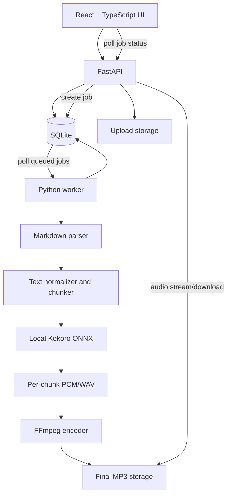
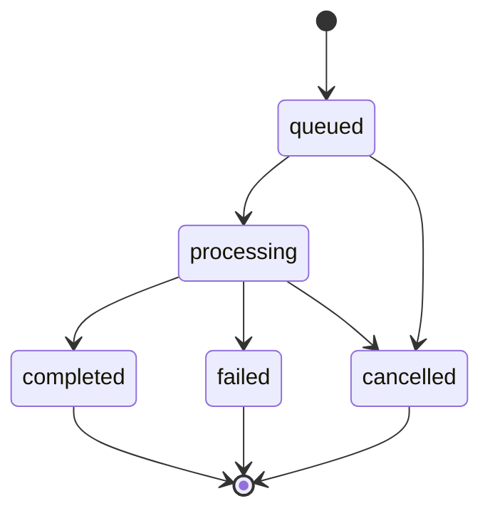

# Mark2Audio — Technical Design

**Status:** Proposed implementation design  
**Version:** 1.0

## 1. Architecture decisions

Mark2Audio uses a **modular monolith** with three runtime containers:

- `frontend`: React + TypeScript + Vite.
- `api`: FastAPI application serving REST endpoints and static-independent API behavior.
- `worker`: Python process consuming persisted conversion jobs and generating audio.

SQLite stores metadata and job state. Local bind mounts or named volumes store uploads, model files, temporary audio, and final output.

No Redis, RabbitMQ, PostgreSQL, or cloud object storage is required for the MVP.

## 2. High-level architecture



## 3. Repository layout

```text
mark2audio/
├── backend/
│   ├── app/
│   │   ├── api/v1/
│   │   ├── core/
│   │   ├── db/
│   │   ├── models/
│   │   ├── schemas/
│   │   ├── repositories/
│   │   ├── services/
│   │   ├── tts/
│   │   ├── workers/
│   │   └── main.py
│   ├── tests/
│   ├── pyproject.toml
│   └── Dockerfile
├── frontend/
│   ├── src/
│   │   ├── components/
│   │   ├── pages/
│   │   ├── hooks/
│   │   ├── lib/
│   │   └── types/
│   ├── package.json
│   └── Dockerfile
├── models/kokoro/
├── data/
│   ├── uploads/
│   ├── audio/
│   ├── temp/
│   └── mark2audio.db
├── docs/
├── docker-compose.yml
├── .env.example
├── Makefile
└── README.md
```

## 4. Backend module responsibilities

| Module                        | Responsibility                                  |
| ----------------------------- | ----------------------------------------------- |
| `api/v1/books.py`             | Upload, list, detail, delete books              |
| `api/v1/jobs.py`              | Create conversion job and read status/cancel    |
| `api/v1/voices.py`            | Report available local voices                   |
| `api/v1/audio.py`             | Stream/download validated output                |
| `services/markdown_parser.py` | Parse Markdown structure into document sections |
| `services/text_normalizer.py` | Convert parsed blocks into narration text       |
| `services/text_chunker.py`    | Split narration into bounded chunks             |
| `tts/engine.py`               | TTS interface/protocol                          |
| `tts/kokoro_onnx.py`          | Kokoro ONNX implementation                      |
| `services/audio_encoder.py`   | FFmpeg invocation and output validation         |
| `workers/audio_worker.py`     | Claim jobs, run pipeline, persist progress      |
| `repositories/`               | Database access and state transitions           |

Keep the TTS engine behind an interface so another local engine can be added without rewriting the pipeline.

## 5. Data model

### Book

- `id`: UUID primary key.
- `title`: user-visible title.
- `original_filename`: sanitized display filename.
- `source_path`: server-controlled relative storage path.
- `status`: `uploaded`, `queued`, `processing`, `completed`, `failed`.
- `created_at`, `updated_at`.

### Chapter

- `id`: UUID primary key.
- `book_id`: foreign key.
- `chapter_number`: integer, unique per book.
- `title`: string.
- `plain_text`: optional persisted normalized text; consider omitting or deleting after conversion for privacy.
- `audio_path`: nullable relative path.
- `duration_seconds`: nullable float.

### ConversionJob

- `id`: UUID primary key.
- `book_id`: foreign key.
- `status`: `queued`, `processing`, `completed`, `failed`, `cancelled`.
- `voice_id`, `language`, `speed`, `bitrate_kbps`.
- `include_code_blocks`, `split_chapters`.
- `total_chunks`, `completed_chunks`, `progress_percent`.
- `current_chapter`: nullable string.
- `error_code`, `error_message`: nullable safe diagnostic fields.
- `created_at`, `started_at`, `completed_at`.

Use SQLAlchemy 2.0 typed mappings. SQLite foreign keys must be enabled. Use short database transactions; never hold a transaction open during TTS inference.

## 6. Job processing design

### Claiming jobs

The worker polls SQLite for the oldest queued job. Claiming must be atomic: update the selected row from `queued` to `processing` only if it is still queued, then verify one row was updated. Run one worker process and one job at a time in the MVP.

### State machine



Do not allow terminal states to transition back to processing. Retrying should create a new job in the MVP.

### Progress

Progress is based on completed synthesis chunks:
`floor(completed_chunks / total_chunks * 100)`.
Reserve 100% for after MP3 validation and final database update. Keep progress monotonic.

### Failure and recovery

- Store a stable error code and safe message.
- Log stack traces server-side with job ID, but not document text.
- On worker startup, mark stale `processing` jobs as failed with `WORKER_RESTARTED`.
- Use a per-job temporary directory.
- Write final output to a temporary filename, validate it, then atomically rename it into place.

## 7. Markdown-to-audio pipeline

1. Validate uploaded file and decode UTF-8.
2. Parse Markdown without executing embedded content or fetching URLs.
3. Build ordered blocks: headings, paragraphs, lists, blockquotes, code, image alt text.
4. Apply narration policy:
   - Strip Markdown syntax.
   - Speak heading text.
   - Preserve list item order.
   - Skip code by default.
   - Convert links to link text by default.
   - Never fetch remote images.
5. Group blocks into chapters.
6. Normalize whitespace and punctuation conservatively.
7. Split each chapter into bounded chunks, preferring paragraph and sentence boundaries.
8. Synthesize each chunk to PCM/WAV.
9. Insert configurable silence between paragraphs/chunks where appropriate.
10. Concatenate chapter audio in source order.
11. Encode to MP3 with FFmpeg.
12. Validate output with `ffprobe`.
13. Atomically publish output and update job/book state.
14. Clean temporary files according to retention settings.

Avoid splitting in the middle of a sentence unless a single sentence exceeds the configured maximum. Keep a mapping from chunk to chapter for progress reporting.

## 8. API contract

Base path: `/api/v1`

| Method   | Path                        | Purpose                          |
| -------- | --------------------------- | -------------------------------- |
| `POST`   | `/books/upload`             | Upload a Markdown file           |
| `GET`    | `/books`                    | List books                       |
| `GET`    | `/books/{book_id}`          | Book details and chapter outline |
| `DELETE` | `/books/{book_id}`          | Delete book and owned files      |
| `GET`    | `/voices`                   | List installed voices            |
| `POST`   | `/books/{book_id}/convert`  | Create conversion job            |
| `GET`    | `/jobs/{job_id}`            | Job status/progress              |
| `POST`   | `/jobs/{job_id}/cancel`     | Request cancellation             |
| `GET`    | `/books/{book_id}/audio`    | Stream/download full MP3         |
| `GET`    | `/books/{book_id}/chapters` | List chapter audio outputs       |

### Upload response

```json
{
  "id": "book-uuid",
  "title": "Example document",
  "status": "uploaded",
  "chapter_count": 4
}
```

### Conversion request

```json
{
  "voice_id": "af_heart",
  "language": "en-us",
  "speed": 1.0,
  "bitrate_kbps": 192,
  "split_chapters": true,
  "include_code_blocks": false
}
```

Validate all values against backend configuration and installed model capabilities.

### Job response

```json
{
  "id": "job-uuid",
  "book_id": "book-uuid",
  "status": "processing",
  "progress_percent": 45,
  "completed_chunks": 9,
  "total_chunks": 20,
  "current_chapter": "Chapter 2",
  "error": null
}
```

Use consistent error responses with a machine-readable code and human-readable message. Never return local absolute paths.

## 9. Frontend design

Pages:

- **Library:** upload dropzone, book cards, status and recent activity.
- **Book detail:** chapter outline, voice/settings form, conversion progress, player, downloads.
- **Settings:** model readiness, storage location/usage, upload limit, audio defaults.

Frontend responsibilities:

- Upload with progress.
- Poll job status at a modest interval (e.g. every 1–2 seconds while processing; stop at terminal state).
- Disable duplicate conversion submissions while an active job exists.
- Render server-side validation messages.
- Use the HTML audio element for playback.
- Do not assume a job completed merely because the upload request succeeded.

## 10. Storage layout

Use server-generated identifiers:

```text
data/
├── uploads/{book_id}/source.md
├── audio/{book_id}/audiobook.mp3
├── audio/{book_id}/chapters/001-chapter-title.mp3
└── temp/{job_id}/...
```

Sanitize chapter names for display only; use stable numbered filenames for storage. Resolve paths under configured roots and verify containment before read/delete operations.

## 11. Docker and local runtime

Services:

- `frontend`
- `api`
- `worker`

Mount `./data` and `./models` as persistent volumes/bind mounts. The API and worker share the same data volume. Do not bake model weights into the application image.

Suggested operational defaults:

- One worker.
- One active conversion at a time.
- CPU inference first; benchmark ONNX execution providers before enabling GPU.
- Health checks for API, FFmpeg availability, model assets, and worker heartbeat.
- Bind published ports to `127.0.0.1` by default.
- Provide a native development mode using `uv` and `pnpm`.

## 12. Technical decisions and open questions

- **TTS engine:** Start with Kokoro ONNX, but confirm exact model artifact, voice assets, runtime API, and licenses before pinning.
- **GPU:** CPU is the baseline. CUDA execution provider is optional and should only be enabled after compatibility testing.
- **Queue:** SQLite-backed polling is adequate for a single-user app. Replace only if measured needs justify it.
- **Migrations:** Use Alembic even with SQLite if schema evolution is expected.
- **Audio stitching:** Verify sample rate, channel count, and sample format are consistent before concatenation.
- **Retention:** Define whether source Markdown and intermediate WAV files remain after successful conversion; default to removing temporary WAVs and retaining source Markdown until book deletion.
