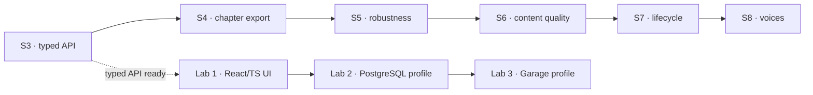

# Mark2Audio — Roadmap

Local-first, offline-capable Markdown-to-audiobook app: upload `.md`, get a downloadable MP3 made
by a local TTS engine. Single user. No accounts, cloud storage, paid APIs or microservices.

Related: [ARCHITECTURE.md](ARCHITECTURE.md) (backend, rules) · [DESIGN.md](DESIGN.md) (UI) ·
[DECISION.md](DECISION.md) · [CLAUDE.md](../CLAUDE.md#21-project-mark2audio) (workflow) ·
sprint docs in `sprints/`.

## Goals

- Convert a Markdown file into a playable, downloadable MP3.
- Run TTS locally with an open model; work offline once dependencies and models are present.
- Preserve reading order and chapter boundaries.
- Clear status and actionable errors.
- Practical on a developer workstation with Docker Compose.

## Non-goals

Cloud hosting, accounts, sync · EPUB/PDF/DOCX/HTML ingestion · voice cloning · collaborative
editing · mobile apps · audiobook mastering or sound effects · Kubernetes or external queues ·
support for every Markdown extension.

## Target user and workflow

Someone with Markdown notes, docs or manuscripts who wants to listen locally. Open the app → upload
`.md` → review title and chapters → pick voice and speed → convert → watch progress → play →
download.

## Requirements status

Baseline MVP requirements (full acceptance criteria: `git show cd46e5b:docs/PRD.md`). Status as
of 2026-11-22. How each is built: [ARCHITECTURE.md](ARCHITECTURE.md).

| ID    | Requirement                                                     | Pri | Status                                |
| ----- | --------------------------------------------------------------- | --- | ------------------------------------- |
| FR-01 | Markdown upload, size/extension/UTF-8 validation, UUID storage  | P0  | Built                                 |
| FR-02 | Parsing and normalization (links as text, code skipped, images) | P0  | Partial: no image alt-text option     |
| FR-03 | Chapter detection from headings, intro, no-heading docs         | P0  | Built, heading level not configurable |
| FR-04 | Voice catalogue from the installed model                        | P0  | Built, verified with real model       |
| FR-05 | Local TTS, chunking, speed 0.8–1.2, progress                    | P0  | Built, verified with real model       |
| FR-06 | FFmpeg MP3 at 128/192/256 kbps, title metadata, probe           | P0  | Built                                 |
| FR-07 | Job lifecycle, monotonic progress, safe errors                  | P0  | Built                                 |
| FR-08 | Library, detail, delete                                         | P0  | Partial: no duration shown            |
| FR-09 | Playback and download                                           | P0  | Built                                 |
| FR-10 | Chapter MP3s and ZIP with manifest                              | P1  | Not built                             |
| FR-11 | Cancellation                                                    | P1  | Built (API, worker, UI)               |

## Sprints

One `feature/sN-<slug>` branch per sprint, one commit per task, release tagged `v0.N.0`.
Per-sprint `PRD.md` and `TODO.md` live in `sprints/SN/`.

| Sprint                  | Theme                                                              | Release  | Status  |
| ----------------------- | ------------------------------------------------------------------ | -------- | ------- |
| [S0](sprints/S0/PRD.md) | Setup: docs, workflow, CI, pre-commit, lockfile                    | `v0.0.0` | Done    |
| [S1](sprints/S1/PRD.md) | Verify the baseline: real model, Docker, offline                   | `v0.1.0` | Done    |
| [S2](sprints/S2/PRD.md) | Ops hardening: worker health check, API errors                     | `v0.2.0` | Done    |
| S3                      | Data foundation: migrations, chapters, durations, typed responses  | `v0.3.0` | Planned |
| S4                      | Chapter export: chapter MP3s and ZIP with manifest                 | `v0.4.0` | Planned |
| S5                      | Robustness and recovery: bad input, FFmpeg failure, crash, headers | `v0.5.0` | Planned |
| S6                      | Content quality: headings, alt text, normalization, pronunciation  | `v0.6.0` | Planned |
| S7                      | Library lifecycle: retention, cleanup, usage, retry, history       | `v0.7.0` | Planned |
| S8                      | Voices and models: hidden voices, model v1.1, voice preview        | `v0.8.0` | Planned |

## Planned scope

One theme per sprint, at most 12 tasks. Scope is fixed only when the sprint PRD exists.

- **S3**: versioned SQL migrations ([D-023](DECISION.md)), `chapters` table and stored durations,
  Pydantic response models ([D-024](DECISION.md)), duration in the UI (FR-08).
- **S4**: chapter MP3s and ZIP with manifest (FR-10), chapter navigation data.
- **S5**: malformed and huge Markdown, FFmpeg failure, kill during encode, orphan cleanup, Host
  header check, CSP, upload and path review, no remote resources, no source text in logs,
  troubleshooting guide, trace the `phonemizer words count mismatch` warnings.
- **S6**: configurable heading level, image alt text, text normalization (numbers, dates, URLs,
  symbols), pronunciation dictionary, pause after headings.
- **S7**: retention and cleanup (technical rule: file and path safety, item 10), storage usage,
  retry as new job, history, queue position, settings page, SQLite backup procedure (WAL is not
  one file).
- **S8**: the 26 hidden non-English voices (verify espeak codes), model release `model-files-v1.1`
  ([D-017](DECISION.md)), voice preview (needs a worker job type: API rule 9), other engines
  behind `TtsEngine`.

## Lab track (optional)

SQLite, local disk and the vanilla UI stay the defaults ([D-022](DECISION.md)). The lab adds
production-style infrastructure for learning, each as its own sprint, decision and compose
profile. The default install and the offline worker proof stay unchanged. One lab sprint at a time,
so a failure has one cause.

- **Lab 1**: React/TypeScript ([D-025](DECISION.md)), Vite build served by the API, types
  generated from OpenAPI.
- **Lab 2**: optional PostgreSQL profile. Needs a repository boundary with two real
  implementations, opt-in tests ([D-026](DECISION.md)), and a SQLite-to-Postgres copy tool.
- **Lab 3**: optional Garage profile. The worker keeps local scratch files and uploads the final
  artifact; the database and the object store cannot share a transaction, so it needs an upload
  state and a reconciliation task.

## Unscheduled candidates

Not assigned to a sprint or the lab.

- Metadata editor, optional cover art.
- Resume from the last successful chunk.
- Upload several files or a ZIP as one book.
- More verified languages and voice packs.
- Extract the inline UI script into its own file.

## Risks

| Risk                              | Mitigation                               |
| --------------------------------- | ---------------------------------------- |
| TTS model/runtime incompatibility | Pin versions, smoke test, verify adapter |
| Large documents exhaust memory    | Bounded chunks, single worker            |
| Chunks sound discontinuous        | Configurable silence (`M2A_SILENCE_MS`)  |
| Markdown edge cases               | Parser fixtures                          |
| FFmpeg missing                    | Health check, setup docs                 |
| Model/voice licensing unknown     | Verify before any distribution           |
| Interrupted conversion            | Stale jobs marked failed on worker start |
